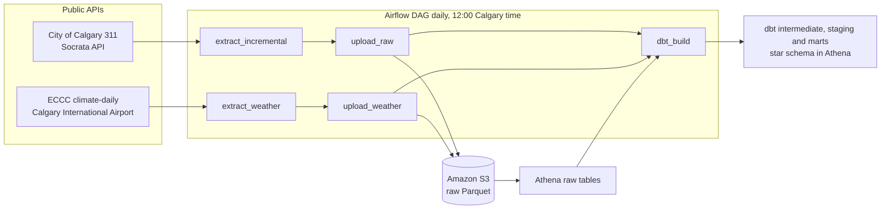
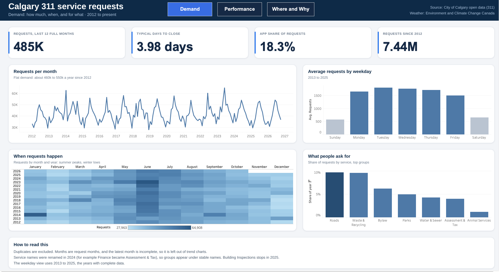
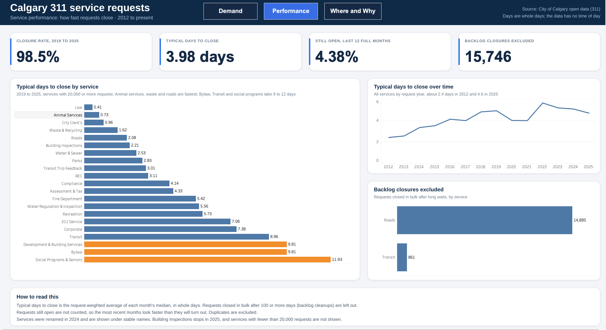
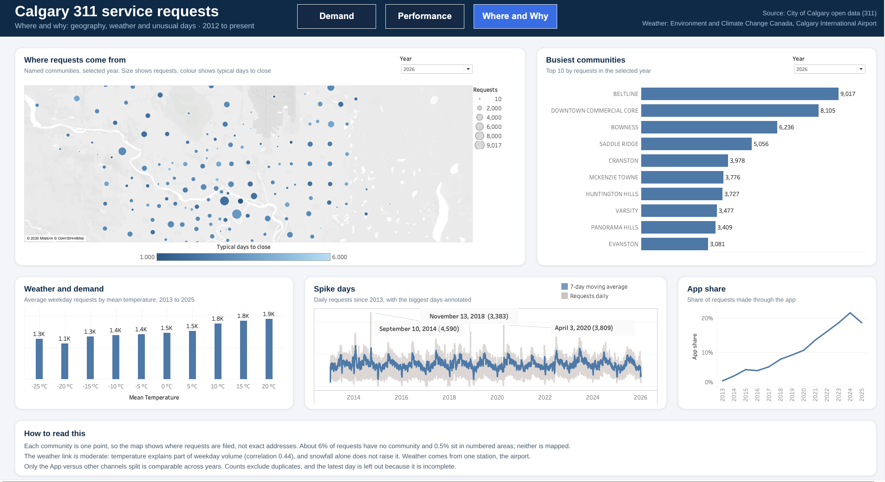

# Calgary Services and Requests Data Pipeline

A daily data pipeline that lands every City of Calgary 311 service request since 2012 and daily weather in AWS,
models them with dbt and publishes analyst-ready tables.

   

## Architecture



| Layer | Technology |
|---|---|
| Extract | Python (`requests`, `polars`) on a shared `BaseExtractor` |
| Raw storage | Amazon S3, append-only Parquet |
| Query engine | Amazon Athena + Glue Data Catalog |
| Transform | dbt (dbt-athena) |
| Orchestration | Apache Airflow 3 in Docker |
| CI | GitHub Actions: ruff, pytest, dbt parse |

## Highlights

- **7.55 million requests** from 2012 to today, refreshed daily and joined to daily weather.
- **Append-only raw layer and incremental loads.** Raw files are never edited; each run re-reads a short overlap, and
  the latest version of each request wins, so re-runs are safe.
- **Row counts checked on every load** against the API's own counts, recorded in a manifest. A mismatch fails the task.
- **Cleaning lives in dbt, not a notebook.** Retired service names, spelling variants and backlog cleanups are handled
  in SQL, under version control, and covered by tests.
- **60+ dbt tests**, run on every Airflow run against the real data.
- **Least-privilege IAM**: one user for the pipeline (S3 only), one for dbt (Athena, Glue, S3).

## Data model

```
fct_service_requests   one row per request: keys, flags, days_to_close
fct_daily_requests     one row per day from 2012: request counts and median days to close, joined to weather
dim_date  dim_status  dim_channel  dim_service  dim_agency  dim_community
```

Staging and intermediate models (`base_service_requests`, `service_name_map`, `stg_service_requests`,
`stg_weather_daily`) are described in [docs/data-cleaning.md](docs/data-cleaning.md).

## Dashboard

The pipeline ends in a three-page Tableau dashboard built on CSV exports of the dbt marts. After `dbt build`, the Airflow DAG runs an `export_marts` task that queries the marts in Athena and writes three CSV files to `s3://<bucket>/exports/`:

| File | Grain |
|---|---|
| `agg_requests_monthly.csv` | month, service group, channel group, legacy flag |
| `agg_requests_community_yearly.csv` | year, community, service group |
| `fct_daily_requests.csv` | day, with weather |

No database is needed for the dashboard: Tableau reads the files directly, so the run from API to dashboard data has no manual steps.

| Page | Question | Screenshot |
|---|---|---|
| Demand | How much, when and for what do people ask? | `docs/images/dashboard-demand.png` |
| Performance | How fast do requests close? | `docs/images/dashboard-performance.png` |
| Where and why | Which communities, what weather, which unusual days? | `docs/images/dashboard-where-and-why.png` |





The dashboard is not hosted. The screenshots above show the three pages.

### Findings
- Demand is flat at roughly 460k to 550k requests a year, with summer peaks and weekday volume well above weekends.
- Weekday volume rises with temperature, from about 1,300 requests a day below -20 °C to about 1,900 above 15 °C.
- The app grew from 1.6% of requests in 2013 to about 22% in 2024.
- Typical time to close rose from about 2.4 days in 2012 to about 4.6 in 2025. Bylaw, Development & Building Services and Social Programs & Seniors are the slowest.
- Three days stand out: 2014-09-10 (4,590 requests), 2020-04-03 (3,809) and 2018-11-13 (3,383).

### Data notes
- Duplicates are excluded from every aggregate.
- 17,798 requests were closed in five bulk clean-up batches. 16,076 of them had waited 100 days or more and are flagged `is_bulk_closure`. The dashboard shows 15,746, because the monthly aggregate leaves out duplicates. They are excluded from days-to-close, mostly Roads (14,885) and Transit (861).
- Services were renamed in 2024, so `service_group_map` maps every group to a stable `reporting_group_name`. The readable names are descriptive, not official City names.
- Requests with no community are grouped as `Unknown` (`has_community = false`) and numbered areas have no coordinates. Neither is mapped (`is_mappable`).
- Channel detail is reliable only before 2021-03-01, so the dashboard compares App against other channels.

## Quick start

Needs Docker, Python 3.12+ with [uv](https://docs.astral.sh/uv/), and an AWS account in `ca-west-1`.

```
cp .env.example .env                                         # bucket and both sets of AWS keys
cp dbt/profiles.yml.example dbt/.dbt/profiles.yml            # adjust the bucket name
uv sync
docker compose up -d --build                                 # Airflow at http://localhost:8080
```

Then run the one-off backfill, create the Athena tables and trigger the `daily` DAG. The full steps, including the
AWS setup, are in [docs/setup.md](docs/setup.md).

## Running the pipeline

Everything runs through one command, configured by `pipeline.yml`:

```bash
uv run stratayyc run        # extract + upload each source, dbt build, export CSVs
uv run stratayyc extract weather --backfill --only 2020 2022   # backfill one source
uv run stratayyc dbt test --select fct_service_requests        # any single step
```

Sources are declared in `pipeline.yml`, so adding one is a config block plus an extractor class. A failed dbt test stops `run` before the export, so a bad build never reaches the dashboard files. Airflow runs the same steps daily.

## Documentation

- [Setup guide](docs/setup.md): AWS setup, backfill, running dbt, repository layout, testing, cost
- [Data cleaning](docs/data-cleaning.md): the rules applied in dbt and why
- [Data quality findings](docs/data-quality.md): what profiling the full history turned up
- [Design decisions](docs/design-decisions.md): the choices behind the pipeline

## Limitations

- Airflow runs in one container with SQLite, which suits one daily job on a laptop, not production. A run is skipped
  if the machine is off, and a gap longer than three days of 311 changes needs a manual backfill.
- Weather comes from a single station (the airport), so it does not describe each neighbourhood.
- Planned: a backfill script, a config-driven command-line entry point, and a dashboard on the marts.